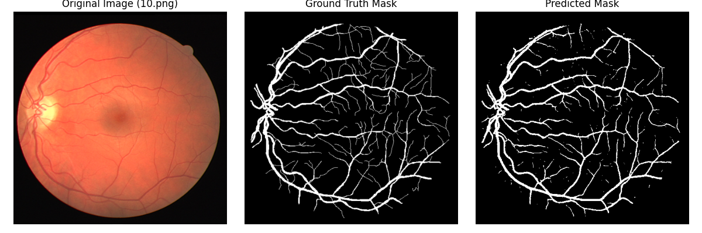
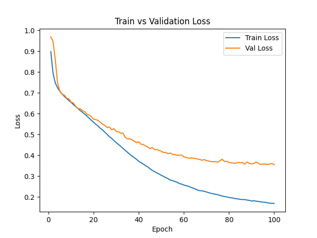

# Retina Vessel Segmentation with UNet

Retina (fundus) görüntülerinde kan damarlarının derin öğrenme ile segmentasyonu. Basit bir UNet mimarisi, **Dice + Focal Loss** birleşik kayıp fonksiyonu ile [Kaggle Retina Blood Vessel](https://www.kaggle.com/datasets/abdallahwagih/retina-blood-vessel/data) veri seti üzerinde eğitilmiştir.



## Sonuçlar

Kaggle'ın ayrı **test seti (20 görüntü)** üzerinde, 0.5 eşik değeriyle:

| Metrik | Değer |
|---|---|
| Ortalama Dice | **0.769** |
| En düşük / en yüksek Dice | 0.720 / 0.808 |

Görüntü bazında skorlar: [`results/dice_scores_test.csv`](results/dice_scores_test.csv). Literatürde retina damar segmentasyonu için tipik Dice değerleri 0.75–0.85 aralığındadır.

Eğitim ve doğrulama kaybı (100 epoch):



## Yöntem

- **Model:** 3 seviyeli encoder–decoder UNet (64 → 128 → 256 → 512 kanal, BatchNorm, skip connection'lar) – `train.py`
- **Kayıp fonksiyonu:** Focal Loss (α = 0.8, γ = 2) + Dice Loss
- **Optimizasyon:** Adam, lr = 1e-4, batch size = 4, 100 epoch; en düşük doğrulama kaybına sahip model kaydedildi (erken durdurma sabrı: 10 epoch)
- **Veri:** 512×512 RGB görüntüler. Kaggle eğitim seti (80 görüntü) %80 / %20 oranında **64 eğitim / 16 doğrulama** olarak bölündü (seed = 42); değerlendirme Kaggle'ın ayrı **20 görüntülük test seti** üzerinde yapıldı.
- **Donanım:** GPU olmadan, CPU üzerinde yerel olarak eğitildi.

## Proje Yapısı

```
├── split_data.py                      # Veriyi train / val / test olarak ayırır
├── train.py                           # Model, dataset, kayıp fonksiyonları ve eğitim
├── test.py                            # Test setinde tahmin + Dice skorları
├── visualize.py                       # Görüntü / gerçek maske / tahmin karşılaştırmaları
├── utils.py                           # Tahmin kaydetme ve Dice hesaplama
├── best_unet_kaggle_split_100ep.pth   # Eğitilmiş model ağırlıkları
├── results/dice_scores_test.csv
├── images/                            # README görselleri
└── docs/                              # Proje raporu
```

## Kurulum ve Kullanım

```bash
python -m venv .venv
.venv\Scripts\activate          # macOS / Linux: source .venv/bin/activate
pip install -r requirements.txt
```

1. [Kaggle veri setini](https://www.kaggle.com/datasets/abdallahwagih/retina-blood-vessel/data) indirin ve arşivdeki `Data/` klasörünün içeriğini proje içinde `KAGGLE_dataset/` adlı klasöre çıkarın (`KAGGLE_dataset/train/image`, `KAGGLE_dataset/train/mask`, `KAGGLE_dataset/test/...`).
2. Veriyi bölün:
   ```bash
   python split_data.py
   ```
3. Hazır modeli test edin (veya `python train.py` ile yeniden eğitin):
   ```bash
   python test.py
   python visualize.py
   ```

## Kaynaklar

1. Ronneberger, O., Fischer, P., & Brox, T. (2015). *U-Net: Convolutional Networks for Biomedical Image Segmentation.* [arXiv:1505.04597](https://arxiv.org/abs/1505.04597)
2. Oliveira, A., Pereira, S., & Silva, C. A. (2018). *Retinal vessel segmentation based on Fully Convolutional Neural Networks.* Expert Systems with Applications, 112, 229–242. [arXiv:1812.07110](https://arxiv.org/abs/1812.07110)
3. Zhou, Z., Siddiquee, M. M. R., Tajbakhsh, N., & Liang, J. (2018). *UNet++: A Nested U-Net Architecture for Medical Image Segmentation.* [arXiv:1807.10165](https://arxiv.org/abs/1807.10165)
